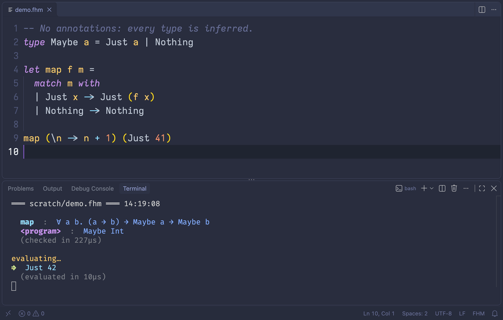

# FHM: Formalised Hindley–Milner

fhm is a small, Elm-flavoured functional language with Hindley–Milner type
inference, algebraic data types and pattern matching, formalised in Lean 4. The
type system is proved sound, inference is proved complete and to find principal
types, and the verified pipeline is the one that actually runs your programs:
from the command line, in your editor, or in a
[browser playground](https://fhm-playground.onrender.com).



## A taste of the language

```
type Maybe a = Just a | Nothing

type Tree a =
  | Leaf
  | Node a (Tree a) (Tree a)

-- No annotations needed: the most general type is inferred.
let map f xs =
  match xs with
  | [] -> []
  | x :: rest -> f x :: map f rest

let find p xs =
  match xs with
  | [] -> Nothing
  | x :: rest -> if p x then Just x else find p rest

-- Annotations are optional, and checked when given.
let insert (n : Int) (tree : Tree Int) : Tree Int =
  match tree with
  | Leaf -> Node n Leaf Leaf
  | Node m l r ->
    if n < m then Node m (insert n l) r
    else Node m l (insert n r)

-- The last expression is the program's result.
(map (\n -> n + 1) [1, 2, 3], (find (\n -> 2 < n) [1, 5, 3], insert 2 (insert 3 Leaf)))
```

Running it with `fhm run` prints the inferred types, then the result:

```text
  insert  :  Int → Tree Int → Tree Int
  find  :  ∀ a. (a → Bool) → List a → Maybe a
  map  :  ∀ a b. (a → b) → List a → List b
  <program>  :  (List Int, (Maybe Int, Tree Int))
  (checked in 4ms)

evaluating…
⟹  ([2, 3, 4], (Just 5, Node 3 (Node 2 Leaf Leaf) Leaf))
  (evaluated in 511µs)
```

Ill-typed programs and non-exhaustive matches are rejected before anything runs.
[Try this example in the playground](https://fhm-playground.onrender.com/#code=1.pZxBDsIwDAT_VG48gl8gTgj-f2LWdtYJoPbQW6W0SVOrcTwb-xCCL_qSsVkDsxaXWmXSf3xz2l0cklSMcUfDyMo3DFJLkfMB1jTq1AGIpDTkOcGpsBMLCDxpv8Mx6Z9esZNhVJH9sFR169CthEtXIHu9dT3Sp8cB60gwfuAZRjWhxIbsqSPPgQ8Z-_urobcKXBmA9wTirv-oOyn3l6me0M091D2za3jnhIr9-AK3R7AqFXb2sZWWV0s-7oAGhAzEI5ll1megeH1CFHok4JrNm9h1NgNS1Vwjb36HS0xPzv8D):
hover over any name to see its type, or break something and watch the errors
appear.

## The language

If you've written Elm, OCaml or Haskell, most of fhm will look familiar. A
program is a list of `type` and `let` declarations followed by one expression,
which is the program's result. These are the parts you might not expect.

### Definitions are recursive, in any order

Any `let` can refer to itself, and to the definitions around it, whether they
come before or after it. There's no `rec` or `and`: fhm works out which
definitions depend on each other and type-checks each group together.

```
let isEven n = if n < 1 then True else isOdd (n - 1)
let isOdd n = if n < 1 then False else isEven (n - 1)
```

### Annotations

Annotations are optional, and checked when given. They can cover a whole
definition or just some of its parameters, and they can leave holes for
inference to fill in. The one rule that might surprise you is that type
variables are never implicitly quantified: `{a}` introduces `a`, and it's in
scope for the whole definition.

```
-- {a} introduces a, which the annotation on acc then refers to.
let reverse : {a} List a -> List a = \xs ->
  let go (acc : List a) ys =
    match ys with
    | [] -> acc
    | y :: rest -> go (y :: acc) rest
  in go [] xs

-- Annotate any mix of parameters. The type after them is the result type.
let clamp (lo : Int) hi n : Int =
  if n < lo then lo else if hi < n then hi else n

-- _ is a hole for inference to fill in. It can even turn out polymorphic.
let length (xs : List _) : Int =
  match xs with
  | [] -> 0
  | _ :: rest -> 1 + length rest

-- ?t is a named hole: each ?t in the annotation stands for the same type.
let twins (pair : (?t, ?t)) = pair
```

fhm infers

```text
reverse : ∀ a. List a → List a
clamp   : Int → Int → Int → Int
length  : ∀ a. List a → Int
twins   : ∀ a. (a, a) → (a, a)
```

and rejects `twins (1, True)`.

### Polymorphic recursion

A definition with a complete type signature can call itself at a different
type. Here `depth` takes a `Nested a`, but recurses into a `Nested (List a)`:

```
type Nested a = Flat a | Nest (Nested (List a))

let depth {a} (nested : Nested a) : Int =
  match nested with
  | Flat _ -> 0
  | Nest inner -> 1 + depth inner
```

Inferring polymorphic recursion is undecidable in general, so, as in Haskell,
the signature is required: without it, or with a hole in it, `depth` is a type
error. Signatures work the same way across mutually recursive definitions.

### Patterns

Patterns can be nested, and work in lambda parameters and `let`s as well as in
`match`. Each name a `let` pattern binds is generalised separately, so `id`
here is still polymorphic:

```
let swap = \(x, y) -> (y, x)
let (id, zero) = (\x -> x, 0)
```

Every match must be exhaustive, including the implicit ones in lambda and `let`
patterns. When one isn't, fhm names a missing case:

```
type Maybe a = Just a | Nothing

let both pair =
  match pair with
  | (Just x, Just y) -> Just (x, y)
  | (Nothing, _) -> Nothing
```

```text
[exhaustiveness] match not exhaustive (missing: (Just _, Nothing))
```

### Everything else

- Built-in `Int`, `Bool`, `Char` and `Unit`, pairs, and lists with list
  literals and `::`.
- `+`, `-` and `<` on integers. No strings yet.
- `if … then … else`, `let … in` blocks, and `--` comments.
- Evaluation is pure. Function arguments are evaluated before the call, but a
  `let`'s right-hand side is evaluated where it's used (call-by-name), so an
  unused binding never runs, and one used twice runs twice.

## What is proved

Everything after parsing is formalised in Lean 4 and machine-checked, with no
`sorry` and only Lean's standard axioms. This is what happens to a program on
its way to being run:

```text
source text
   │ lex and parse                       (not verified)
   ▼
surface syntax tree       ◄── check that every match is exhaustive
   │ lower
   ▼
Core term                 ◄── infer types and check annotations
   │ erase annotations
   ▼
untyped Core term
   │ evaluate, one small step at a time
   ▼
value
```

Nothing is evaluated unless both checks pass.

The surface syntax tree is the program as written, with names, nested patterns
and syntactic sugar. Core is a much smaller language with de Bruijn indices and
only flat, one-constructor-deep matches. Lowering gets from one to the other: it
resolves names, desugars pairs, lists, `if` and function heads, and compiles
nested patterns into flat matches. Annotations come through unchanged, holes and
all, and are only erased once inference has checked them. Two smaller jobs
happen along the way: the parser groups each block of definitions by which ones
depend on each other, and data declarations become the table of constructors
that every later stage consults.

Apart from the parser itself, every step is proved to meet a specification:

| Stage                  | What is proved                                                                                                      | Main theorems                                                                             |
| ---------------------- | ------------------------------------------------------------------------------------------------------------------- | ----------------------------------------------------------------------------------------- |
| Grouping definitions   | Each block is split into exactly its strongly connected components, dependencies first.                             | `SurfaceBridge.sccGroups_sound`, `SurfaceBridge.sccGroups_complete`, `Scc.kosaraju_sound` |
| Data declarations      | Declarations are accepted exactly when they're well-formed, and produce exactly the constructors written, in order. | `elabDecls_eq_some_iff`, `elabDecls_complete`                                             |
| Lowering               | The lowerer agrees exactly with a declarative specification of lowering.                                            | `SurfaceBridge.lowerProgram_sound`, `SurfaceBridge.lowerProgram_complete`                 |
| Pattern compilation    | A compiled match picks the same branch, with the same bindings, as the nested patterns it came from.                | `PatComp.compile_correct_surface`, `PatComp.lowerMatch_adequate_of_typed`                 |
| Exhaustiveness         | If the checker accepts a program, all its matches are exhaustive.                                                   | `SurfaceBridge.checkExhaustive_sound`                                                     |
| Inference is sound     | The inferred type can be derived with the declarative typing rules, `InputTyping`.                                  | `inferWithTypes_input_sound`                                                              |
| Inference is complete  | If a program has any type at all, inference succeeds.                                                               | `inferWithTypes_complete`                                                                 |
| Inference is principal | Every type the program can be given is an instance of the inferred one.                                             | `inferWithTypes_principal`                                                                |
| Erasure                | Erasing annotations preserves the type.                                                                             | `InputTyping.erase`                                                                       |
| Evaluation             | A closed, well-typed term with exhaustive matches is a value or can take a step, and stepping preserves its type.   | `RuntimeTyping.RunWT.progress`, `RuntimeTyping.RunWT.preservation`                        |

Put together, these give the end-to-end result,
`SurfaceBridge.program_type_safe`: a program that lowers, type-checks and passes
the exhaustiveness check never gets stuck, and every state it reaches has the
type that was inferred for it. [`FHM/Headlines.lean`](./FHM/Headlines.lean)
collects the main theorems in one place.

**What is not verified:** the lexer and parser, the CLI and editor tooling, and
the loop that drives evaluation in `fhm run`. That loop calls the verified
single-step function, but keeps going until the program finishes, and fhm
programs don't have to finish. The verified alternative is `runSafe` in
`Headlines.lean`, which takes a step budget and whose return type rules out
getting stuck. The CLI also uses a version of the lowerer that tracks source
locations for error messages and hovers. It's proved to produce the same Core
term, but the location tracking itself isn't verified. All of this lives in
[`FHM/Unverified/`](./FHM/Unverified/README.md), which the default `lake build`
doesn't import.

## Getting started

You need [`elan`](https://github.com/leanprover/elan); the pinned Lean version
is in [`lean-toolchain`](./lean-toolchain).

```bash
lake exe cache get   # download prebuilt Mathlib (avoids compiling it locally)
lake build           # check all the proofs
lake build fhm       # build the fhm executable
```

### Running programs

```bash
.lake/build/bin/fhm run program.fhm                # infer types, then evaluate
.lake/build/bin/fhm run --fuel 100000 program.fhm  # stop after 100000 evaluation steps
.lake/build/bin/fhm run --json program.fhm         # the same, as JSON
```

Evaluation also stops, with an `eval.depthLimit` error, if the expression being
evaluated gets nested more than 512 levels deep. This guards against
overflowing the native stack, and is separate from `--fuel`.

For a REPL-like loop that re-runs the program every time you save:

```bash
scripts/watch-live.sh                     # watches scratch/live.fhm
scripts/watch-live.sh path/to/program.fhm
```

This uses `entr` or `fswatch` if available and falls back to polling.

### Browser playground

The playground at <https://fhm-playground.onrender.com> type-checks and
evaluates your program as you type, with inline errors and hover types. The URL
always holds the current program, so it doubles as a share link. It's on a free
plan, so the first visit after a quiet spell can take a minute to wake up.

To run it locally:

```bash
lake build fhm
cd editors/web
npm install
npm run dev          # http://localhost:5173
```

### VS Code / Cursor

[`editors/vscode/`](./editors/vscode/) adds syntax highlighting, diagnostics,
hover types and go-to-definition:

```bash
scripts/install-vscode-extension.sh   # VS Code
scripts/install-cursor-extension.sh   # Cursor
```

Reload the window afterwards. The extension runs the workspace's
`.lake/build/bin/fhm`, so rebuild that after changing the compiler.

## Under the hood

The design choices that matter most:

- **Evaluation is type-free.** Annotations are only used for type checking,
  and are erased before the program runs. No type information exists at
  runtime.
- **Declarative and algorithmic typing are kept separate.** `InputTyping`
  defines which programs are well-typed, as a set of rules that say nothing
  about how to find the types. Inference (`inferWithTypes`, in the style of
  Algorithm W) computes them, and is proved sound and complete with respect to
  `InputTyping`. The rules treat an annotation with holes as a template the
  type has to fit, with each hole standing for some type. Only inference ever
  deals in unification variables.
- **Type variables use a locally nameless representation** with cofinite
  quantification, following
  [Charguéraud's formalisation of mini-ML](https://github.com/charguer/formalmetacoq).
  Term variables use de Bruijn indices.
- **Pattern compilation** uses a
  [Maranget](https://dl.acm.org/doi/10.1145/1411204.1411211)-style pattern
  matrix. Recursive groups are found with a verified Kosaraju SCC algorithm.

### Repository map

| Module                                                         | Contents                                                                                                        |
| -------------------------------------------------------------- | --------------------------------------------------------------------------------------------------------------- |
| [`Core.lean`](./FHM/Core.lean)                                 | Types, the Core language (shared by annotated source and erased runtime terms), and its small-step semantics    |
| [`SourceTyping.lean`](./FHM/SourceTyping.lean)                 | `InputTyping`, the declarative type system, and the proof that erasure preserves types                          |
| [`InferW.lean`](./FHM/InferW.lean)                             | Type inference and its soundness proof                                                                          |
| [`Completeness.lean`](./FHM/Completeness.lean)                 | Completeness and principality of inference                                                                      |
| [`RuntimeTyping.lean`](./FHM/RuntimeTyping.lean)               | Typing for erased terms, with progress and preservation                                                         |
| [`AnnotationMatching.lean`](./FHM/AnnotationMatching.lean)     | What it means for a type to fit an annotation with holes                                                        |
| [`AnnotationAllocation.lean`](./FHM/AnnotationAllocation.lean) | How inference fills in and checks an annotation's holes                                                         |
| [`SourceAnnotations.lean`](./FHM/SourceAnnotations.lean)       | Written signatures, and how absent, partial and complete ones are checked                                       |
| [`InferenceFoundations.lean`](./FHM/InferenceFoundations.lean) | Substitution, unification, generalisation and recursive-group scheduling                                        |
| [`SourceSupport.lean`](./FHM/SourceSupport.lean)               | Operations on source terms, and the state inference keeps for recursive groups                                  |
| [`SurfaceLang.lean`](./FHM/SurfaceLang.lean)                   | The surface syntax tree                                                                                         |
| [`SurfaceBridge.lean`](./FHM/SurfaceBridge.lean)               | Lowering from surface to Core, recursive grouping, and exhaustiveness checking                                  |
| [`SurfaceSafety.lean`](./FHM/SurfaceSafety.lean)               | The end-to-end safety theorem                                                                                   |
| [`PatComp.lean`](./FHM/PatComp.lean)                           | The pattern-match compiler and its correctness proofs                                                           |
| [`Scc/Kosaraju.lean`](./FHM/Scc/Kosaraju.lean)                 | Verified strongly connected components                                                                          |
| [`Decls.lean`](./FHM/Decls.lean)                               | Data declaration checking                                                                                       |
| [`Headlines.lean`](./FHM/Headlines.lean)                       | The main theorems in one place, plus the proof-carrying evaluator `runSafe`                                     |
| [`Examples.lean`](./FHM/Examples.lean)                         | Worked derivations; [`Examples/Programs.lean`](./FHM/Examples/Programs.lean) has accepted and rejected programs |
| [`Unverified/`](./FHM/Unverified/README.md)                    | Lexer, parser, CLI, editor support, unbounded evaluator                                                         |

## Roadmap

Known bugs and smaller tasks are tracked in [`TODO.md`](./TODO.md).

Near term:

- **Better error messages.** Application errors explain mismatches at the
  offending expression; extend these diagnostics to recursive groups, matches
  and the rest of the pipeline.
- **String literals**.

Further out:

- **Row types** and records.
- **Type system experiments** of my own, built on this foundation.

## My motivation

I've been interested in type systems for a long time, and I really enjoy working in ML-style pure languages like e.g. Elm. At the same time I've been frustrated by Elm's limitations and wanted to create my own implementation of an Elm-like language that I could steer according to my own instincts and desired features.

I've also had some ideas for novel type system features, some of which I haven't seen mentioned in the literature. I'd like to explore what is involved in implementing those and to see if I could make them work. So this project really serves two purposes: both a pedagogical project for my own learning about well-trodden PLT grounds, and also to serve as a testbed for exploring my own type system ideas, once the stable HM (and perhaps row types) foundations are in place.

For this I've leaned quite a bit on LLMs. Mainly in two ways:

- As tutor: to bounce ideas off of, to get feedback on my designs, but also to help me explore – and understand – relevant papers when I can't figure out how to solve a problem. I've spent quite a bit of time talking to claude (mostly opus 4.8) getting it to explain certain concepts to me, in different ways, using different examples. I would propose my own simpler solutions and it would give me a counterexample to illustrate why that idea won't work. This has proven massively useful to me and I certainly would not have the understanding I have now had I not done this work.
- Proof workhorse: I've used LLMs to do most of the proving grunt-work. Although there have been quite a few moments when in the midst of trying to amend a broken theorem after adding a new feature, it realised that the original theorem was now false as stated. At that point it would surface the issue to me, I'd interrogate it, making sure I had a clear grasp of the issue. It would propose some solutions, I'd usually need to push it to make sure we were actually coming up with the most principled solution, rather than an ad hoc one. Once I decided on a solution, I'd prompt it to execute the amended brief.

This workflow has been very fruitful, both in getting this formalisation to the mature point it is now, and also in advancing my own learning. I learn best by building, and this has been an incredibly successful way for me to learn and absorb the relevant material.

## References

- J. Roger Hindley. _The principal type-scheme of an object in combinatory logic._ Transactions of the American Mathematical Society 146:29–60, 1969. <https://doi.org/10.1090/S0002-9947-1969-0253905-6>
- Robin Milner. _A theory of type polymorphism in programming._ Journal of Computer and System Sciences 17(3):348–375, 1978. <https://doi.org/10.1016/0022-0000(78)90014-4>
- Luis Damas and Robin Milner. _Principal type-schemes for functional programs._ POPL 1982, 207–212. <https://doi.org/10.1145/582153.582176>
- Alan Mycroft. _Polymorphic type schemes and recursive definitions._ International Symposium on Programming, LNCS 167, 217–228, 1984. <https://doi.org/10.1007/3-540-12925-1_41>
- Fritz Henglein. _Type inference with polymorphic recursion._ ACM TOPLAS 15(2):253–289, 1993. <https://doi.org/10.1145/169701.169692>
- A. J. Kfoury, J. Tiuryn, and P. Urzyczyn. _Type reconstruction in the presence of polymorphic recursion._ ACM TOPLAS 15(2):290–311, 1993. <https://doi.org/10.1145/169701.169687>
- Simon Peyton Jones and Mark Shields. _Lexically scoped type variables._ Microsoft Research, 2002. <https://www.microsoft.com/en-us/research/publication/lexically-scoped-type-variables/>
- Luc Maranget. _Compiling pattern matching to good decision trees._ ML Workshop 2008. <https://dl.acm.org/doi/10.1145/1411204.1411211>
- François Pottier and Didier Rémy. _The essence of ML type inference._ In B. C. Pierce (ed.), Advanced Topics in Types and Programming Languages, ch. 10, 389–489. MIT Press, 2005. <https://pauillac.inria.fr/~fpottier/publis/emlti-final.pdf>
- Brian Aydemir, Arthur Charguéraud, Benjamin C. Pierce, Randy Pollack, and Stephanie Weirich. _Engineering formal metatheory._ POPL 2008, 3–15. <https://doi.org/10.1145/1328438.1328443>
- Arthur Charguéraud. _The locally nameless representation._ Journal of Automated Reasoning 49(3):363–408, 2012. <https://doi.org/10.1007/s10817-011-9225-2>. Coq sources: <https://github.com/charguer/formalmetacoq> (the `ln/ML_*` files).
